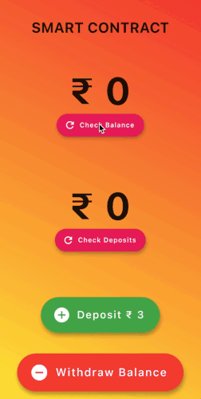

# BlockChain Flutter

A small Flutter app that reads from and writes to an Ethereum smart contract running on a local Ganache chain. I built it in 2022 to learn how a mobile client talks to a contract through JSON-RPC using `web3dart`.



## What it does

The contract, `contracts/Investment.sol`, is a toy savings plan. It stores two numbers, deposits and balance:

- `addDepositAmount(amount)` adds to the deposit total. Once deposits reach 12, the balance becomes deposits plus a fixed return of 3.
- `withdrawBalance()` resets both values to 0.
- `getDepositAmount()` and `getBalanceAmount()` return the current values.

No ether actually moves. The values are just contract state, and each write is a signed transaction.

The app has four buttons: check balance, check deposits, deposit 3, and withdraw. Reads go through `eth_call`; writes are signed with a local account's private key and sent with `sendTransaction`.

## Stack

- Flutter (beta channel at the time, Dart `>=2.17.0-69.2.beta`)
- [web3dart](https://pub.dev/packages/web3dart) 1.2.3 and `http` 0.12.2
- Solidity 0.5.16, compiled and deployed with Truffle
- Ganache as the local chain (RPC on port 7545, network id 5777)

These are the versions it was built against. I haven't checked it on current Flutter or Truffle releases.

## Project layout

```
contracts/       Investment.sol and the standard Truffle Migrations contract
migrations/      Truffle deploy scripts
src/abis/        Compiled contract artifacts (ABI + deployed address), bundled as a Flutter asset
lib/main.dart    Web3 client setup and contract read/write helpers
```

## Running it locally

1. Start Ganache on `http://127.0.0.1:7545`.
2. Deploy the contract with Truffle (`truffle migrate`). There's no `truffle-config.js` in this repo, so you'll need one that points at port 7545 and writes artifacts to `./src/abis/` (or copy `build/contracts/Investment.json` there afterwards). The app reads the contract address from `networks["5777"]` in that file.
3. In `lib/main.dart`, set `privateKey` to one of your Ganache account keys and check `rpcUrl`. It's `http://0.0.0.0:7545`; an Android emulator needs `http://10.0.2.2:7545` to reach the host.
4. `flutter pub get` then `flutter run`.

## Current state

The committed `lib/main.dart` has the client setup and the contract helpers, but the `build()` method for the screen in the demo GIF never made it into the repo, so it won't compile as-is. `test/widget_test.dart` is still the default counter test from `flutter create`.
